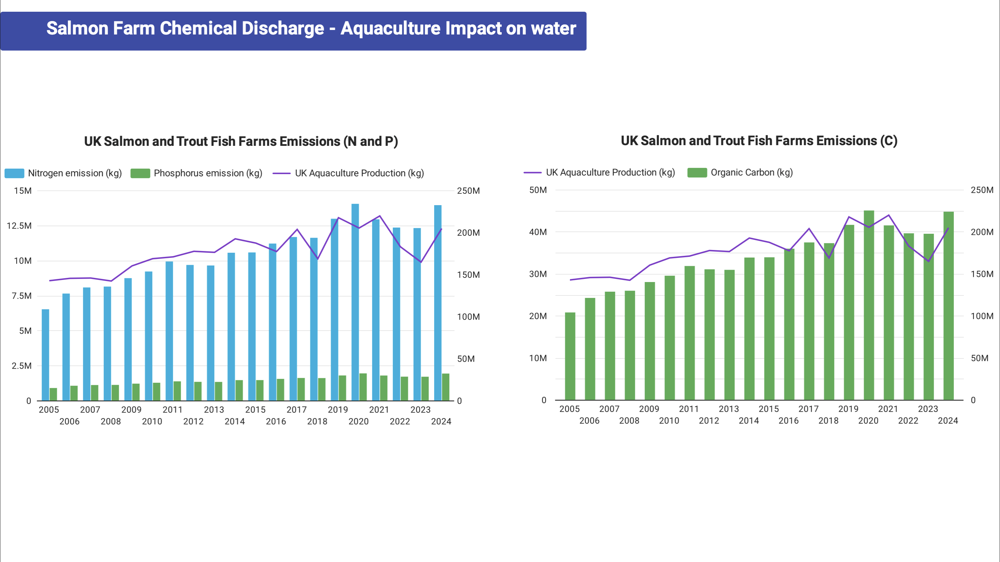
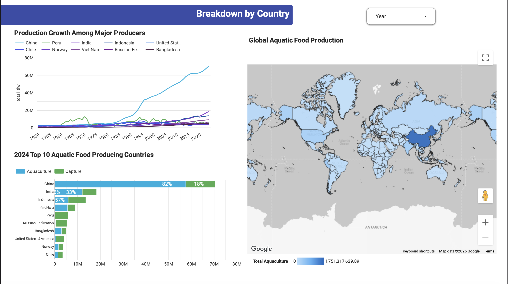

# From Wild Catch to Aquaculture
### Exploring Global Aquatic Food Production, Sustainability and Environmental Impacts

## Project Overview

In 2022, aquaculture surpassed capture fisheries for the first time in global aquatic animal production, marking a major transformation in the way the world produces aquatic food.

This project investigates the shift from wild-caught fisheries to aquaculture, exploring the drivers behind this transition and its potential environmental implications.

Developed as the final project of the Le Wagon Data Analytics Bootcamp, the analysis combines international datasets from the Food and Agriculture Organization (FAO) and the Scottish Environment Protection Agency (SEPA), using SQL and Looker Studio to analyse trends and communicate insights through interactive data visualisations.

## Research Question

**If wild-capture fisheries cannot grow indefinitely, where is the growth in global aquatic food production coming from?**

## Project Objectives

- Analyse the evolution of global capture fisheries and aquaculture production over recent decades.
- Investigate the growth of aquaculture in relation to wild-capture fisheries.
- Identify the countries, species and aquatic environments contributing to this transition.
- Explore the sustainability of wild fish stocks.
- Examine potential environmental pressures associated with aquaculture expansion, including chemical discharges from fish farming.
- Communicate findings through interactive dashboards and data visualisations.

## Data Sources

The project uses publicly available datasets from the following organisations:

**Food and Agriculture Organization of the United Nations (FAO)**

- [Global Capture Fisheries Production (1950–2024)](https://www.fao.org/fishery/collection/capture/en)
- [Global Aquaculture Production (1950–2024)](https://www.fao.org/fishery/collection/aquaculture/en)
- [SDG Indicator 14.4.1 — Sustainable Fish Stocks](https://dataexplorer.fao.org/vis?fs%5B0%5D=D%2Co&pg=0&fc=Domain&bp=true&snb=3&df%5Bds%5D=ds-release&df%5Bid%5D=DF_SDG_14_4_1&df%5Bag%5D=FAO&df%5Bvs%5D=1.0&dq=A...........&pd=2020%2C2021&to%5BTIME_PERIOD%5D=false)
- [Global Fish Consumption and Food Balance Sheets](https://www.fao.org/fishery/collection/global_fish_consump/en)

**Scottish Environment Protection Agency (SEPA)**

- [Fish Farm Annual Emissions Dataset](https://aquaculture.scotland.gov.uk/Resources/DatasetDescriptions/FishFarmAnnualEmissions)

## Tools & Technologies

- **SQL** — Data querying and analysis.
- **Looker Studio** — Interactive dashboards and data visualisation.
- **FAO and SEPA datasets** — International fisheries, aquaculture and environmental data.

## Key Analytical Indicators

- **Sustainable Fish Stocks:** Proportion of assessed fish stocks within biologically sustainable levels.
- **Aquaculture Share:** Proportion of total aquatic animal production contributed by aquaculture.
- **Chemical Discharges:** Nitrogen, phosphorus and carbon released into aquatic environments through fish farming.
- **Apparent Fish Consumption:** Annual fish and seafood consumption, measured in total quantities and per capita.
- **Compound Annual Growth Rate (CAGR):** Average annual growth rate over a defined period.

## Dashboard Structure

The analysis is organised into two main parts:

**Part I — Understanding the Aquaculture Transition**

1. Global Overview — Production trends and the shift towards aquaculture.
2. Aquatic Environments — Production across marine, freshwater and brackish environments.
3. Country Analysis — Major producers and their contributions to aquaculture growth.
4. Species Analysis — Species composition and its role in the transition.

**Part II — Exploring Environmental Implications**

5. Scottish Salmon Farming: A Case Study — Chemical discharges and potential environmental pressures associated with fish farming.

6. ## Key Findings & Environmental Insights

### Scottish Salmon and Trout Farming — Environmental Implications

To investigate the potential environmental impacts of aquaculture, the project examined annual emissions data from salmon and trout farms in Scotland, using nitrogen, phosphorus and organic carbon as indicators.

These elements are important indicators of aquatic environmental health. When released in excessive quantities, nutrients such as nitrogen and phosphorus can contribute to eutrophication, encouraging excessive algae growth and reducing dissolved oxygen levels. This can negatively affect fish and other aquatic organisms.

**Key observation:**

The analysis identified an increase over time in the quantities of nutrients released by the fish farms examined, highlighting the importance of monitoring environmental emissions alongside aquaculture production growth.

**Why this matters:**

The transition towards aquaculture may help address growing global demand for aquatic food, but increased production also brings environmental considerations. Sustainable development requires balancing food production with the protection of aquatic ecosystems.

## Dashboard & Project Files

[View the Interactive Looker Studio Dashboard](https://datastudio.google.com/s/j7WGNKIEVvw)

**Project PDF:** `From_Wild_Catch_to_Aquaculture.pdf`

## Dashboard Visualisations

### Aquaculture Impact on Water

### Breakdown by Country

### Global Transition Scenario

## Project
