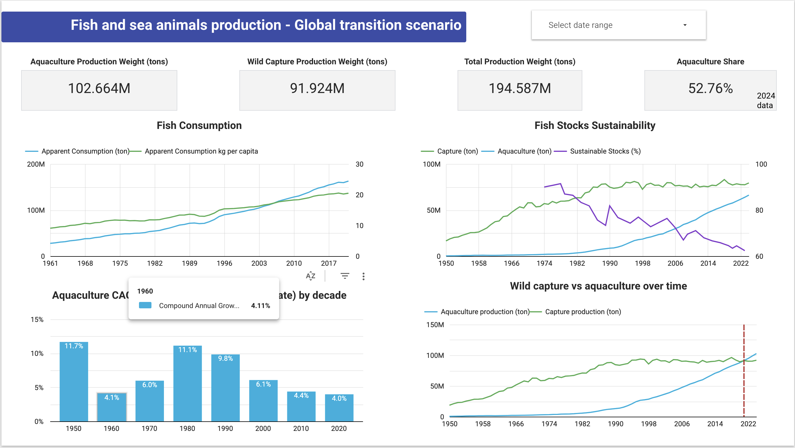

# From Wild Catch to Aquaculture

## Project Overview

This project explores the relationship between wild-caught fisheries and aquaculture, using data analysis and visualisation to investigate trends in aquatic food production.

The project was developed as part of my final project at Le Wagon's Data Analytics bootcamp, using data visualisation to communicate findings and support a better understanding of the aquaculture sector.

## Project Objectives

- Explore trends in wild-capture fisheries and aquaculture.
- Analyse relevant data to identify patterns and developments.
- Present findings through interactive data visualisations.
- Communicate insights in an accessible and informative dashboard.

## Tools & Technologies

- Looker Studio
- Data analysis and visualisation

## Dashboard

[View the interactive Looker Studio dashboard](https://datastudio.google.com/s/j7WGNKIEVvw)

## Project Files

- `From_Wild_Catch_to_Aquaculture.pdf` — PDF export of the project dashboard.

## Project Status

Completed — Le Wagon Data Analytics Bootcamp Final Project.

## Dashboard Visualisations

### Aquaculture Impact on Water

### Breakdown by Country

### Global Transition Scenario

